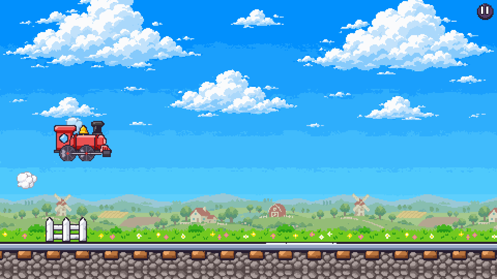
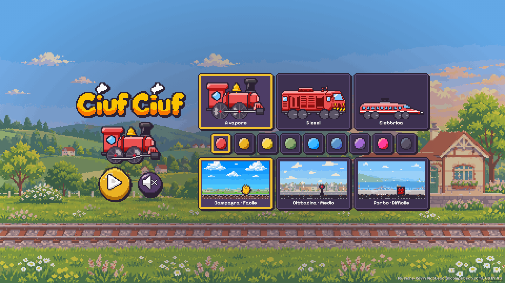
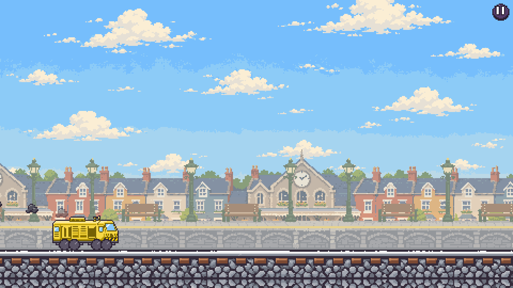
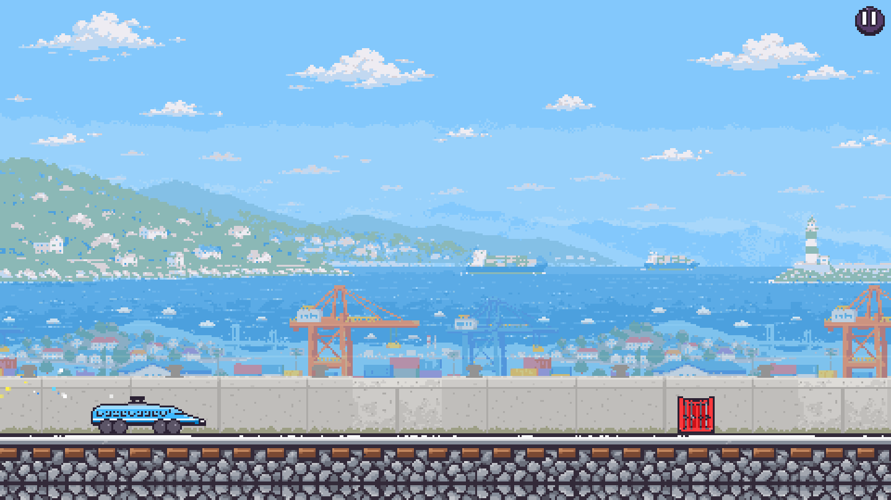

# Ciuf Ciuf

**Una locomotiva corre lungo i binari: salta gli ostacoli e arriva in stazione.**

[Gioca sul web](https://imaginesoftware.it/ciufciuf-play/) · [Pagina del progetto](https://imaginesoftware.it/open-source-projects/ciufciuf)



Gioco web 2D per tutti, pensato perché il livello facile sia giocabile anche da una bambina di quattro anni:
un solo comando, partite brevi con un traguardo, nessun punteggio.

## Come si gioca

- **Spazio** sul computer, **un tocco ovunque** su tablet e telefono: la locomotiva salta.
- Nel menu si scelgono la locomotiva (a vapore, diesel, elettrica), il colore e lo scenario, senza bisogno
  di saper leggere: tutto è a figure, le parole sono solo didascalie.
- La partita finisce in stazione con «Hai vinto!». Esc o il bottone in alto a destra la mettono in pausa.

| Scenario | Livello | Durata | Cosa succede |
| --- | --- | --- | --- |
| Campagna | Facile | 40 s | Un ostacolo alla volta; se lo urti viene sbalzato via e il treno riparte |
| Cittadina con stazione | Medio | 60 s | Sequenze più fitte, un urto ferma la corsa |
| Porto con gru e navi | Difficile | 80 s | Più veloce, container a più piani e travi da passare *senza* saltare |







## Com'è fatto

- **PixiJS 8**, Vite e TypeScript; menu e fine partita sono pagine HTML, Pixi disegna solo la corsa.
- **Pixel art a 480×270**, ingrandita di un fattore intero. Sprite e sfondi sono generati con AI e ripuliti a
  codice ([`docs/prompt-pixel-art.md`](docs/prompt-pixel-art.md)); ruote, bielle e scintille del pantografo
  sono disegnate a codice. Il colore della locomotiva si cambia sostituendo la palette della carrozzeria.
- **Suoni veri**: registrazioni di treni (sbuffi, motori, fischi) e una musica per scenario, con la marcia
  che accelera e rallenta insieme al treno.
- **Ogni ostacolo è superabile per costruzione**: `validaConfigurazione` verifica a ogni avvio in sviluppo, e
  in un test sulla configurazione rilasciata, che a ogni velocità ci sia una finestra utile per saltare e che
  sotto le travi si passi da terra.
- Nessun tracciamento, nessuna pubblicità, nessun dato raccolto: le preferenze restano nel browser.

Decisioni, conti e storia dello sviluppo: [ROADMAP.md](ROADMAP.md).

## Sviluppo

Il gioco sta in `Web/`.

```sh
cd Web
npm install
npm run dev     # http://localhost:5173/ciufciuf-play/
npm test        # validaConfigurazione sulla configurazione rilasciata
npm run build
```

Il bilanciamento dei tre livelli sta in `Web/src/config/livelli.ts`; i testi in `Web/src/testi.ts`. Il build
si pubblica nella sottocartella `ciufciuf-play/` del sito Imagine Software.

## Crediti e licenza

Codice e pixel art sotto licenza [MIT](LICENSE). Musiche di Kevin MacLeod (CC BY 4.0), effetti sonori CC0 da
Freesound, font Pixelify Sans: elenco completo in [THIRD-PARTY-NOTICES.md](THIRD-PARTY-NOTICES.md).
